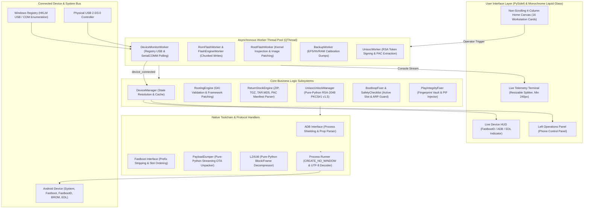

# FlashDock

> Personal, unified desktop Android service workstation for Windows — featuring automated rooting, bootloader unlocking, multi-format firmware flashing, partition backup/rescue, and low-level chipset recovery.

<p align="center">
  
  
  
  
</p>

<p align="center">
  <a href="CHANGELOG.md"></a>
  <a href="LICENSE"></a>
  <a href="tests/"></a>
  <a href="flashdock/ui/styles.py"></a>
  <a href="flashdock/ui/icon_assets.py"></a>
</p>

---

**Start here** · [GitHub downloads](https://github.com/klein-sys/own-flasher/releases) · [Run from source](#option-b-run-from-source) · [Version history](CHANGELOG.md) · [v1.8 roadmap](V1.8-PLAN.md)

To sideload an app, connect an authorized Android device and open **Sideload & App Manager → Packages and Bundles**. Drop or browse for a package, wait for validation, then select **Arm Write → Review Install**. Check the target phone, versions, and installation options before confirming.

## Monochrome Liquid Glass workstation

Version 1.7.0 groups the existing 16 tools into four inset glass workflow sheets. Pearl Light and Obsidian Dark share a painted ambient field, cursor-reactive highlights, smoked icon droplets, and a unified device island. The home workspace and compact sidebar fit without scrolling. The activity console opens from the footer.

The write switch starts Safe and locks write-capable screens until armed. Changing the device serial or connection mode returns it to Safe. Each workflow retains its existing preflight checks and simulation settings. The island displays reported telemetry and leaves unknown slots unset.

Version 1.7.1 lets you drop or browse for Android packages and recovery ZIPs in Write: Safe. Arm Write and connect in the appropriate ADB mode to install a package or apply an OTA.

Version 1.7.2 validates packages in the background. Damaged packages stay blocked and FlashDock asks for a fresh copy.

Version 1.7.3 keeps install readiness visible, compares app versions, and reviews the selected device and options before installing.

The SVG source pack can be regenerated with `python scripts/generate_bw_icons.py`. Its assets and the glass stylesheet are included in the Windows bundle.


## Tech Stack

| Area | Technology | Purpose |
| :--- | :--- | :--- |
| **Language & Runtime** | Python 3.10 – 3.14 (`3.14.7` tested) | Standard-library pure-Python engine: RSA PKCS#1 v1.5 signer, LZ4 decompressor, and Protobuf OTA payload unpacker without external C-extensions. |
| **Desktop UI Framework** | PySide6 (`Qt 6.12`) | Native Windows desktop GUI, non-blocking `QThread` workers, and high-DPI responsive rendering. |
| **Design System & HiDPI** | Monochrome Liquid Glass | Pearl Light and Obsidian Dark, painted specular sheets, a device island, and a dynamic SVG icon factory. |
| **Device Communication** | ADB, Fastboot, FastbootD | Android userspace communication, sparse chunk flashing, and dynamic partition management. |
| **Low-Level Hardware** | Qualcomm EDL 9008, MediaTek BROM, Unisoc FDL | Emergency COM serial handshake, bootloader bypass, and deep unbrick flashing. |
| **Protocol Handshakes** | Pure-Python Win32 Transport (`ctypes`) | Zero-dependency Qualcomm Sahara Hello (`0x01`), MediaTek BROM 4-byte echo (`0xA0..0x05` -> `0x5F..0xFA`), and Unisoc HDLC (`0x7E` + CRC-16/XMODEM). |
| **Hardware Events** | Win32 `WM_DEVICECHANGE` Broadcasts | Instant (<50ms) hardware arrival/removal detection (`DBT_DEVICEARRIVAL`, `DBT_DEVICEREMOVECOMPLETE`) replacing idle registry polling. |
| **Zero-Copy Streaming** | Python `mmap.mmap` + `memoryview` | Zero-copy slicing for multi-GB OTA `payload.bin` and Samsung `.img.lz4` firmware archives. |
| **Distribution** | PyInstaller | Standalone Windows builds. Consult the release notes for signing and checksum information. |

---

## Overview

FlashDock replaces the fragmented, untrusted, and dangerous landscape of legacy cracked GSM repair utilities (Odin, SP Flash Tool, Mi Flash, fastboot scripts, manual payload extractors, and ad-hoc driver bundles) with a unified, personal engineering workstation.

Designed specifically for personal device ownership, development, and enthusiast servicing, FlashDock operates strictly locally on your workstation. It wraps complex OEM protocols and fastboot operations in safety gates—mandating calibration backups (`efs`, `nvram`, `nvdata`, `persist`, `sec_efs`), checking battery charge ($\ge 30\%$), querying active A/B slot integrity, and rejecting improper bootloader relocks.

---

## Key Features

### 1. Device Diagnostics & FastbootD Live HUD
* **Real-Time Mode Resolution**: Instantly classifies connected hardware across ADB (System), Bootloader (Fastboot), FastbootD (Userspace dynamic partitions), Recovery, Qualcomm EDL 9008, MediaTek BROM, and Unisoc SPRD.
* **FastbootD Differentiation**: Explicit Bootloader and FastbootD Userspace labels distinguish the connection modes in the monochrome interface.
* **Hardware & Battery Telemetry**: Queries active slot (`_a` or `_b`), Knox warranty bit, bootloader unlock state, battery level, SoC chipset architecture, and baseband version.
* **Automated Pre-Flight Checklist**: 18-point safety verification suite ensuring battery reserve, authorized USB debugging, free disk space ($\ge 2\text{ GB}$), and driver handshakes.

### 2. Dual-Mode Boot Image Patching & Root Engine
* **Pre-Patched Direct Import Mode**: Directly loads, validates kernel headers, and flashes existing Magisk (`magisk_patched_*.img`) or KernelSU (`kernelsu_*.img`) images straight to the target slot.
* **Device-Assisted ADB Pipeline**: Automatically pushes stock `boot.img` or `init_boot.img` to `/sdcard/Download/`, executes the Magisk/KernelSU patch script via ADB shell, and retrieves the patched output into `data/tools/patched_boot/`.
* **Pure-Python GKI Header Parser**: Validates `boot_img_hdr` versions (v0 through v4) and enforces targeting `init_boot.img` on Android 13+ GKI kernels.
* **Play Integrity Fixer & Spoofer**: Real-time attestation diagnostics (`BASIC`, `DEVICE`, `STRONG`), built-in certified OEM fingerprint profile vault with 1-click injection to `/data/adb/pif.json`, and automated Play Services cache flush.
* **Root Modules Manager**: Inspects `/data/adb/modules`, toggles modules, and provides an Emergency Bootloop Kill-Switch (`.disable`).

### 3. Unisoc 1-Click Token Unlocker & Anti-Red-State Shield
* **Unisoc token utilities**: The source includes RSA token-handling utilities. The Windows distribution includes no usable built-in private signing key.
* **Anti-Red-State Shield**: One-click deployment of custom disabled `vbmeta.img` (`fastboot --disable-verity --disable-verification flash vbmeta vbmeta.img`) to prevent immediate bootloops upon unlocking.
* **Transsion OEM Integration**: Integrated directly into Tecno, Infinix, and itel brand workflow guides.

### 4. Built-in `payload.bin` Dumper & Samsung `.lz4` Decompressor
* **Streaming OTA Dumper**: Pure-Python varint/protobuf parser for Android Delta/Full OTA `payload.bin` archives. Extracts individual critical partitions (`boot.img`, `init_boot.img`, `recovery.img`, `vbmeta.img`) in seconds without unpacking multi-gigabyte ZIP archives.
* **Chunked Samsung LZ4 Decompressor**: Pure-Python byte-stream decoder to decompress Samsung Odin `AP_*.tar.md5` archives directly into clean `.img` files.

### 5. Multi-Format Factory Restore & Custom ROM Flashing
* **Format Expansion**: Natively parses, extracts, and validates `.zip`, `.tgz` / `.tar.gz` (Xiaomi fastboot ROMs), `.tar.md5` (Samsung Odin), `.pac` (Unisoc), and standalone `payload.bin` images.
* **Chunked Sparse Flasher**: Flashes partition images with real-time byte progress, dry-run safety verification, and hash checking.
* **1-Click A/B Slot Switchboard**: Immediate slot toggling (`fastboot --set-active=other`) directly from the Reboot Switchboard and Phone Control Panel for instant bootloop rollback.

### 6. Emergency Rescue, Sideloading & Workstation Utilities
* **Offline Recovery Dumps**: Partition dumping in custom recovery mode (`TWRP`/`OrangeFox`) where ADB has root permissions (`uid=0`), without requiring `su -c`.
* **Universal Sideload & App Manager**: Drag-and-drop installer for APKs, split XAPKs, and APKS bundles with Android 14+ low-target-SDK bypass (`--bypass-low-target-sdk-block`) and recovery OTA sideloading.
* **Safe Non-Root Debloater**: Disables carrier and OEM bloatware packages via `pm uninstall -k --user 0` with categorized presets.
* **Low-Latency Screen Mirroring (`scrcpy`)**: High-speed display mirroring and mouse/keyboard input control launched with console popup suppression (`CREATE_NO_WINDOW`).
* **OEM Driver & Toolchain Manager**: One-click updates for Android platform-tools and driver INF installation via `pnputil` with automated PowerShell UAC elevation.

---

## Subsystem Architecture



### Subsystem Responsibilities
1. **Hardware Polling Engine (`DeviceMonitorWorker`)**: Zero-dependency background thread polling Windows Registry keys (`HKLM\SYSTEM\CurrentControlSet\Enum\USB` and `HKLM\HARDWARE\DEVICEMAP\SERIALCOMM`) every 1.5 seconds. Reconciles hardware states without flooding ADB or Fastboot daemon sockets.
2. **Core Engines**: Stateless business modules enforcing calibration dumps, GKI boot header integrity, and cryptographic token generation.
3. **Toolchain Wrappers**: Standardized execution harnesses featuring explicit UTF-8 encoding shields (`errors="replace"`) and console window suppression (`CREATE_NO_WINDOW`).
4. **Vector SVG Engine (`icon_assets.py`)**: 100% vector SVG rendering using native `QSvgRenderer` with dynamic color tinting across Dark (`#0D1117`) and Light (`#F0F2F5`) themes.

---

## Project Structure

```text
FlashDock/
├── flashdock/
│   ├── brands/               # OEM brand handlers (Google, Xiaomi, Samsung, Transsion, etc.)
│   ├── core/                 # Core domain logic
│   │   ├── backup.py         # Partition calibration dumping & ADB user backups
│   │   ├── bootloop_fixer.py # Slot rollback, verity bypass, and safe mode recovery
│   │   ├── device.py         # DeviceInfo model & mode classification
│   │   ├── device_manager.py # Thread-safe hardware state coordinator
│   │   ├── return_stock.py   # Multi-format factory restore manifest engine
│   │   ├── rom_flasher.py    # Custom ROM & GSI partition flashing engine
│   │   ├── rooting.py        # Dual-mode boot patching & GKI validation
│   │   ├── tools_manager.py  # Platform-tools & elevated INF driver installation
│   │   └── unisoc.py         # Pure-Python RSA-2048 token signer & vbmeta generator
│   ├── tools/                # Low-level protocol wrappers & extractors
│   │   ├── adb.py            # Android Debug Bridge subprocess interface
│   │   ├── fastboot.py       # Fastboot / FastbootD interface with prefix hardening
│   │   ├── lz4_util.py       # Pure-Python chunked LZ4 block & frame decompressor
│   │   ├── mmap_stream.py    # Zero-copy memory-mapped streaming & safe archive extractors
│   │   ├── payload_dumper.py # Pure-Python streaming OTA payload.bin extractor
│   │   ├── runner.py         # Subprocess runner with UTF-8 shield & window suppression
│   │   ├── scrcpy.py         # Low-latency display mirror process manager
│   │   ├── usb_transport.py  # Pure-Python Win32 Sahara, BROM & Unisoc HDLC transport
│   │   └── win32_device_events.py # Win32 WM_DEVICECHANGE instant hardware event listener
│   ├── ui/                   # PySide6 desktop interface
│   │   ├── screens/          # 16 specialized workstation screens
│   │   │   ├── backup_screen.py
│   │   │   ├── downloads_screen.py
│   │   │   ├── flash_rom_screen.py
│   │   │   ├── integrity_screen.py
│   │   │   ├── mtk_unisoc_screen.py
│   │   │   ├── return_stock_screen.py
│   │   │   ├── root_screen.py
│   │   │   ├── sideload_screen.py
│   │   │   ├── unbrick_screen.py
│   │   │   └── unlock_screen.py
│   │   ├── widgets/          # Reusable workstation UI components
│   │   │   ├── device_hud.py         # Live status visualizer & FastbootD indicator
│   │   │   ├── device_selector.py    # Bottom bar serial selection combobox
│   │   │   ├── flash_shield.py       # Critical operation modal with process locking
│   │   │   ├── key_guide_dialog.py   # Hardware key combos & virtual keypad (ADB)
│   │   │   ├── phone_panel.py        # Left navigation sidebar & quick switchboard
│   │   │   ├── reboot_switchboard.py # Slot toggle & power mode dispatcher
│   │   │   ├── side_terminal.py      # Resizable live telemetry terminal
│   │   │   └── workflow_guide.py     # Interactive 16-tool clickable guide dialog
│   │   ├── icon_assets.py    # 100% Vector SVG graphics factory
│   │   ├── main_window.py    # Main workstation canvas & navigation coordinator
│   │   └── styles.py         # Pearl Light / Obsidian Dark stylesheet loader
│   └── workers/              # Asynchronous QThread background workers
│       ├── device_monitor.py # Windows Registry & daemon polling loop
│       └── flash_engine.py   # Flashing and backup worker threads
├── scripts/                  # Release packaging, signing, and verification scripts
│   ├── apply_v150_hardening.py # AST-verified codebase hardening & integration script
│   ├── release_build.py      # Automated build, test, signing, and ZIP packaging
│   ├── sign_app.ps1          # Authenticode SHA-256 certificate generation & signing
│   └── version_info.txt      # Windows executable version resource
├── tests/                    # 611 unit, integration & binary fuzzing tests across 50 modules
├── RELEASE_NOTES_v1.5.0.md   # Official v1.5.0 release notes & architectural change manifest
├── main.py                   # Application entry point
├── flashdock.spec            # PyInstaller distribution build specification
└── requirements.txt          # Python dependencies (PySide6, pytest)
```

---

## Getting Started

### Prerequisites
* **Operating System**: Windows 10 (Build 19041+) or Windows 11 (64-bit).
* **Hardware Connection**: Quality USB 2.0 or USB 3.0 cable connected directly to the motherboard port (avoid unpowered USB hubs).
* **Android prerequisites**: Enable USB debugging for ADB features and authorize the computer on the phone. Bootloader workflows have their own device-specific requirements.

---

### Option A: Standalone Windows Binary

Get the **Windows x64 ZIP** from [GitHub Releases](https://github.com/klein-sys/own-flasher/releases/latest). Extract the entire ZIP, then open `FlashDock.exe` or `Run-FlashDock.bat`. See the [Windows quick start](WINDOWS-QUICKSTART.md) for checksums, Platform-Tools, and the source fallback if Windows blocks the unsigned build.

If you see **Smart App Control blocked an app**, use **Option B** below. The v1.7.4 executable is unsigned, and its batch launcher opens the same executable.

---

### Option B: Run from Source

Download the **developer ZIP** from [GitHub Releases](https://github.com/klein-sys/own-flasher/releases/latest) or clone the repository for Git history. Install Python x64, run `Setup-FlashDock.bat` from the new folder, then open `Run-Via-Python.bat`. The [developer setup guide](DEVELOPER-SETUP.md) covers testing, rebuilding, and continuing work on another PC.

---

## Recommended Safe Workflow

Follow this workflow to reduce the risk of data loss or a failed flash.

```text
[Step 1: Diagnose] ──► [Step 2: Pre-Flight] ──► [Step 3: Backup EFS] ──► [Step 4: Unlock/Flash] ──► [Step 5: Verify]
  Live HUD Check        Safety Checklist        Calibration Dump        Fastboot/D Writing       Integrity Check
```

1. **Diagnose**: Connect your phone in normal system mode with USB debugging enabled. Verify the Live Device HUD reflects your exact device model, battery status ($\ge 30\%$), and current partition slot (`_a` or `_b`).
2. **Pre-Flight**: Navigate to **Safety Checklist** (`ChecklistScreen`). Click **Run Pre-Flight Check** to verify battery reserve, storage free space, and USB driver readiness.
3. **Mandatory Backup**: Navigate to **Backup / Restore** (`BackupScreen`). Perform a raw dump of calibration partitions (`efs`, `nvram`, `nvdata`, `persist`, `sec_efs`) to `data/backups/`.
4. **Bootloader Unlock / Flash**:
   * For standard devices: Use **Unlock Bootloader** to execute official OEM unlock flows.
   * For Unisoc / Transsion devices: Use the **Unisoc Token Unlocker** to generate a cryptographic `signature.bin` and deploy disabled `vbmeta`.
   * For flashing: Select target firmware in **Flash ROM / GSI** or **Return to Stock** and execute via the asynchronous flashing engine.
5. **Verify & Tweak**: After rebooting, use **Fix Play Integrity** to inject certified fingerprint configurations or **Diagnostics & Tweaks** to optimize UI animation scales.

---

## Safety & Zero-Brick Protocols

FlashDock enforces strict hardware safety guardrails at every layer of the workstation:

1. **Active Slot Desync Guard**: On A/B and Virtual A/B devices, FlashDock validates the active boot slot before writing any partition. If Fastboot reports an ambiguous or null slot, slot-targeted flashing is immediately aborted.
2. **Anti-Rollback (ARP) & eFuse Protection**: Binary inspection of Android kernel headers (`boot_img_hdr`) validates kernel versions before writing to prevent triggering hardware rollback counters (Qualcomm QFUSE, Samsung Knox 0x1).
3. **Mandatory Calibration Pre-Backups**: Critical radio and factory calibration blocks (`efs`, `nvram`, `nvdata`, `persist`, `sec_efs`) are backed up with SHA-256 validation before partition write operations begin.
4. **Strict Anti-Relock Gate**: FlashDock prevents bootloader relocking (`fastboot flashing lock`, `oem lock`) if a custom ROM, modified kernel, or cross-region firmware is installed, preventing unrecoverable AVB verification bricks.
5. **Low-Disk Space Abort**: Write operations halt immediately if free workstation disk space drops below 2.0 GB.
6. **Zero Telemetry & Secret Masking**: All logs and crash dumps automatically redact sensitive identifiers:
   * IMEI: `[REDACTED_IMEI]`
   * MEID: `[REDACTED_MEID]`
   * Android ID: `[REDACTED_ANDROID_ID]`
   * Device Serial: `[REDACTED_SERIAL]`
   * Local User Paths: `[USER_DIR]`

---

## Testing & Quality Verification

FlashDock maintains an automated test suite covering all core engines, toolchain wrappers, parser logic, and GUI components.

```powershell
# Run the complete test suite
.\.venv\Scripts\python.exe -m pytest tests/ -q

# Run automated release verification & compilation
.\build.bat
```

### Verification Results

* All 698 automated tests passed on the v1.7.4 release snapshot. Sideload tests use simulated devices.
* The developer ZIP was extracted into a fresh folder on Windows 11 x64. Setup, source launch, tests, and rebuilding the Windows ZIP passed there. Smart App Control blocked the unsigned packaged executable on that PC, and physical USB workflows are still unverified.
* Both themes were visually checked at 1260×780 and the dashboard at 900×600. Previews use sample device telemetry.
* Native compositor appearance requires a live Windows visual check. Long tool forms and data lists retain scrolling.


---

## Contributing

Contributions, bug reports, and hardware profile updates are welcome!

1. Fork the repository on GitHub (`https://github.com/klein-sys/own-flasher`).
2. Create a feature branch: `git checkout -b feat/new-chipset-support`.
3. Adhere to FlashDock's engineering standards:
   * Keep GUI operations non-blocking using `QThread`.
   * Use 100% vector SVG icons via `flashdock.ui.icon_assets` (no raw emoji stickers in the UI).
   * Ensure 100% test pass rate across `pytest tests/`.
4. Submit a Pull Request with a clear description and testing evidence.

---

## License

Distributed under the **MIT License**. See [LICENSE](LICENSE) for full details.
