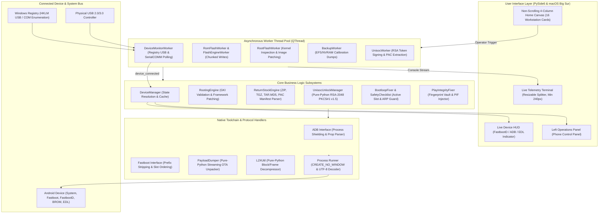

# FlashDock

> Personal, unified desktop Android service workstation for Windows — featuring automated rooting, bootloader unlocking, multi-format firmware flashing, partition backup/rescue, and low-level chipset recovery.

<p align="center">
  
  
  
  
</p>

<p align="center">
  <a href="https://github.com/klein-sys/own-flasher"></a>
  <a href="LICENSE"></a>
  <a href="tests/"></a>
  <a href="flashdock/ui/styles.py"></a>
  <a href="flashdock/ui/icon_assets.py"></a>
</p>

---

## Tech Stack

| Area | Technology | Purpose |
| :--- | :--- | :--- |
| **Language & Runtime** | Python 3.10 – 3.14 (`3.14.7` tested) | Standard-library pure-Python engine: RSA PKCS#1 v1.5 signer, LZ4 decompressor, and Protobuf OTA payload unpacker without external C-extensions. |
| **Desktop UI Framework** | PySide6 (`Qt 6.10`) | Native Windows desktop GUI, non-blocking `QThread` workers, and high-DPI responsive rendering. |
| **Design System** | macOS Big Sur & Xiaomi HyperOS 2.0 | Slate Obsidian / Soft Frost themes, Apple HIG typography, squircle badges, and 100% dynamic vector SVG icon factory (zero unicode emoji stickers). |
| **Device Communication** | ADB, Fastboot, FastbootD | Android userspace communication, sparse chunk flashing, and dynamic partition management. |
| **Low-Level Hardware** | Qualcomm EDL 9008, MediaTek BROM, Unisoc FDL | Emergency COM serial handshake, bootloader bypass, and deep unbrick flashing. |
| **Hardware Polling** | Win32 Windows Registry | Real-time asynchronous polling of USB hubs (`HKLM\SYSTEM\CurrentControlSet\Enum\USB`) and COM serial devices (`HKLM\HARDWARE\DEVICEMAP\SERIALCOMM`). |
| **Distribution & Security** | PyInstaller, Authenticode SHA-256 | Standalone Windows executable distribution, Zone.Identifier unblocker scripts, and Smart App Control compliance. |

---

## Overview

FlashDock replaces the fragmented, untrusted, and dangerous landscape of legacy cracked GSM repair utilities (Odin, SP Flash Tool, Mi Flash, fastboot scripts, manual payload extractors, and ad-hoc driver bundles) with a unified, personal engineering workstation.

Designed specifically for personal device ownership, development, and enthusiast servicing, FlashDock operates strictly locally on your workstation. It wraps complex OEM protocols and fastboot operations in safety gates—mandating calibration backups (`efs`, `nvram`, `nvdata`, `persist`, `sec_efs`), checking battery charge ($\ge 30\%$), querying active A/B slot integrity, and rejecting improper bootloader relocks.

---

## Key Features

### 1. Device Diagnostics & FastbootD Live HUD
* **Real-Time Mode Resolution**: Instantly classifies connected hardware across ADB (System), Bootloader (Fastboot), FastbootD (Userspace dynamic partitions), Recovery, Qualcomm EDL 9008, MediaTek BROM, and Unisoc SPRD.
* **FastbootD Differentiation**: Displays distinct visual badges for standard Bootloader (`#007AFF` Cobalt) versus FastbootD Userspace (`#00E5FF` Cyan) so dynamic partition writes are never dispatched to incompatible bootloaders.
* **Hardware & Battery Telemetry**: Queries active slot (`_a` or `_b`), Knox warranty bit, bootloader unlock state, battery level, SoC chipset architecture, and baseband version.
* **Automated Pre-Flight Checklist**: 18-point safety verification suite ensuring battery reserve, authorized USB debugging, free disk space ($\ge 2\text{ GB}$), and driver handshakes.

### 2. Dual-Mode Boot Image Patching & Root Engine
* **Pre-Patched Direct Import Mode**: Directly loads, validates kernel headers, and flashes existing Magisk (`magisk_patched_*.img`) or KernelSU (`kernelsu_*.img`) images straight to the target slot.
* **Device-Assisted ADB Pipeline**: Automatically pushes stock `boot.img` or `init_boot.img` to `/sdcard/Download/`, executes the Magisk/KernelSU patch script via ADB shell, and retrieves the patched output into `data/tools/patched_boot/`.
* **Pure-Python GKI Header Parser**: Validates `boot_img_hdr` versions (v0 through v4) and enforces targeting `init_boot.img` on Android 13+ GKI kernels.
* **Play Integrity Fixer & Spoofer**: Real-time attestation diagnostics (`BASIC`, `DEVICE`, `STRONG`), built-in certified OEM fingerprint profile vault with 1-click injection to `/data/adb/pif.json`, and automated Play Services cache flush.
* **Root Modules Manager**: Inspects `/data/adb/modules`, toggles modules, and provides an Emergency Bootloop Kill-Switch (`.disable`).

### 3. Unisoc 1-Click Token Unlocker & Anti-Red-State Shield
* **Pure-Python Cryptographic Signer**: Queries `fastboot oem get_identifier_token` on Unisoc/Spreadtrum devices (Tecno Pop, Infinix Smart, itel, Realme C, Motorola E), signs the 64-character token using an integrated RSA-2048 community private key via PKCS#1 v1.5 with SHA-256, and dispatches `fastboot flashing unlock_bootloader signature.bin`.
* **Anti-Red-State Shield**: One-click deployment of custom disabled `vbmeta.img` (`fastboot --disable-verity --disable-verification flash vbmeta vbmeta.img`) to prevent immediate bootloops upon unlocking.
* **Transsion OEM Integration**: Integrated directly into Tecno, Infinix, and itel brand workflow guides.

### 4. Built-in `payload.bin` Dumper & Samsung `.lz4` Decompressor
* **Streaming OTA Dumper**: Pure-Python varint/protobuf parser for Android Delta/Full OTA `payload.bin` archives. Extracts individual critical partitions (`boot.img`, `init_boot.img`, `recovery.img`, `vbmeta.img`) in seconds without unpacking multi-gigabyte ZIP archives.
* **Chunked Samsung LZ4 Decompressor**: Pure-Python byte-stream decoder to decompress Samsung Odin `AP_*.tar.md5` archives directly into clean `.img` files.

### 5. Multi-Format Factory Restore & Custom ROM Flashing
* **Format Expansion**: Natively parses, extracts, and validates `.zip`, `.tgz` / `.tar.gz` (Xiaomi fastboot ROMs), `.tar.md5` (Samsung Odin), `.pac` (Unisoc), and standalone `payload.bin` images.
* **Chunked Sparse Flasher**: Flashes partition images with real-time byte progress, dry-run safety verification, and hash checking.
* **1-Click A/B Slot Switchboard**: Immediate slot toggling (`fastboot --set-active=other`) directly from the Reboot Switchboard and Phone Control Panel for instant bootloop rollback.

### 6. Emergency Rescue, Sideloading & Workstation Utilities
* **Offline Recovery Dumps**: Partition dumping in custom recovery mode (`TWRP`/`OrangeFox`) where ADB has root permissions (`uid=0`), without requiring `su -c`.
* **Universal Sideload & App Manager**: Drag-and-drop installer for APKs, split XAPKs, and APKS bundles with Android 14+ low-target-SDK bypass (`--bypass-low-target-sdk-block`) and recovery OTA sideloading.
* **Safe Non-Root Debloater**: Disables carrier and OEM bloatware packages via `pm uninstall -k --user 0` with categorized presets.
* **Low-Latency Screen Mirroring (`scrcpy`)**: High-speed display mirroring and mouse/keyboard input control launched with console popup suppression (`CREATE_NO_WINDOW`).
* **OEM Driver & Toolchain Manager**: One-click updates for Android platform-tools and driver INF installation via `pnputil` with automated PowerShell UAC elevation.

---

## Subsystem Architecture



### Subsystem Responsibilities
1. **Hardware Polling Engine (`DeviceMonitorWorker`)**: Zero-dependency background thread polling Windows Registry keys (`HKLM\SYSTEM\CurrentControlSet\Enum\USB` and `HKLM\HARDWARE\DEVICEMAP\SERIALCOMM`) every 1.5 seconds. Reconciles hardware states without flooding ADB or Fastboot daemon sockets.
2. **Core Engines**: Stateless business modules enforcing calibration dumps, GKI boot header integrity, and cryptographic token generation.
3. **Toolchain Wrappers**: Standardized execution harnesses featuring explicit UTF-8 encoding shields (`errors="replace"`) and console window suppression (`CREATE_NO_WINDOW`).
4. **Vector SVG Engine (`icon_assets.py`)**: 100% vector SVG rendering using native `QSvgRenderer` with dynamic color tinting across Dark (`#0D1117`) and Light (`#F0F2F5`) themes.

---

## Project Structure

```text
FlashDock/
├── flashdock/
│   ├── brands/               # OEM brand handlers (Google, Xiaomi, Samsung, Transsion, etc.)
│   ├── core/                 # Core domain logic
│   │   ├── backup.py         # Partition calibration dumping & ADB user backups
│   │   ├── bootloop_fixer.py # Slot rollback, verity bypass, and safe mode recovery
│   │   ├── device.py         # DeviceInfo model & mode classification
│   │   ├── device_manager.py # Thread-safe hardware state coordinator
│   │   ├── return_stock.py   # Multi-format factory restore manifest engine
│   │   ├── rom_flasher.py    # Custom ROM & GSI partition flashing engine
│   │   ├── rooting.py        # Dual-mode boot patching & GKI validation
│   │   ├── tools_manager.py  # Platform-tools & elevated INF driver installation
│   │   └── unisoc.py         # Pure-Python RSA-2048 token signer & vbmeta generator
│   ├── tools/                # Low-level protocol wrappers & extractors
│   │   ├── adb.py            # Android Debug Bridge subprocess interface
│   │   ├── fastboot.py       # Fastboot / FastbootD interface with prefix hardening
│   │   ├── lz4_util.py       # Pure-Python chunked LZ4 block & frame decompressor
│   │   ├── payload_dumper.py # Pure-Python streaming OTA payload.bin extractor
│   │   ├── runner.py         # Subprocess runner with UTF-8 shield & window suppression
│   │   └── scrcpy.py         # Low-latency display mirror process manager
│   ├── ui/                   # PySide6 desktop interface
│   │   ├── screens/          # 16 specialized workstation screens
│   │   │   ├── backup_screen.py
│   │   │   ├── downloads_screen.py
│   │   │   ├── flash_rom_screen.py
│   │   │   ├── integrity_screen.py
│   │   │   ├── mtk_unisoc_screen.py
│   │   │   ├── return_stock_screen.py
│   │   │   ├── root_screen.py
│   │   │   ├── sideload_screen.py
│   │   │   ├── unbrick_screen.py
│   │   │   └── unlock_screen.py
│   │   ├── widgets/          # Reusable workstation UI components
│   │   │   ├── device_hud.py         # Live status visualizer & FastbootD indicator
│   │   │   ├── device_selector.py    # Bottom bar serial selection combobox
│   │   │   ├── flash_shield.py       # Critical operation modal with process locking
│   │   │   ├── key_guide_dialog.py   # Hardware key combos & virtual keypad (ADB)
│   │   │   ├── phone_panel.py        # Left navigation sidebar & quick switchboard
│   │   │   ├── reboot_switchboard.py # Slot toggle & power mode dispatcher
│   │   │   ├── side_terminal.py      # Resizable live telemetry terminal
│   │   │   └── workflow_guide.py     # Interactive 16-tool clickable guide dialog
│   │   ├── icon_assets.py    # 100% Vector SVG graphics factory
│   │   ├── main_window.py    # Main workstation canvas & navigation coordinator
│   │   └── styles.py         # macOS Big Sur & HyperOS design tokens
│   └── workers/              # Asynchronous QThread background workers
│       ├── device_monitor.py # Windows Registry & daemon polling loop
│       └── flash_engine.py   # Flashing and backup worker threads
├── scripts/                  # Release packaging, signing, and verification scripts
│   ├── release_build.py      # Automated build, test, signing, and ZIP packaging
│   ├── sign_app.ps1          # Authenticode SHA-256 certificate generation & signing
│   └── version_info.txt      # Windows PE version resource descriptor
├── tests/                    # 480 unit and integration tests across 47 modules
├── main.py                   # Application entry point
├── flashdock.spec            # PyInstaller distribution build specification
└── requirements.txt          # Python dependencies (PySide6, pytest)
```

---

## Getting Started

### Prerequisites
* **Operating System**: Windows 10 (Build 19041+) or Windows 11 (64-bit).
* **Hardware Connection**: Quality USB 2.0 or USB 3.0 cable connected directly to the motherboard port (avoid unpowered USB hubs).
* **Android Prerequisites**: `USB Debugging` and `OEM Unlocking` enabled under *Settings > Developer Options*.

---

### Option A: Standalone Windows Binary (Recommended)

1. **Download Release**: Grab the latest release package (`FlashDock-v1.4.0-windows-x64.zip`) from the [Releases](https://github.com/klein-sys/own-flasher/releases) page.
2. **Extract Archive**: Extract the ZIP archive to a local folder (e.g., `C:\Tools\FlashDock\`).
3. **Launch Workstation**:
   * Double-click **`Run-FlashDock.bat`** (automatically strips Windows Mark-of-the-Web `Zone.Identifier` download flags and launches `FlashDock.exe`).
   * *(Optional)* Double-click **`Install-Certificate.bat`** once to add FlashDock's Authenticode SHA-256 certificate to your local *Trusted Publishers* store to satisfy Windows Smart App Control.

---

### Option B: Run from Source

```powershell
# 1. Clone the repository
git clone https://github.com/klein-sys/own-flasher.git
cd own-flasher

# 2. Create and activate a clean virtual environment
python -m venv .venv
.venv\Scripts\activate

# 3. Install core dependencies
pip install -r requirements.txt

# 4. Launch FlashDock
python main.py
```

---

## Recommended Safe Workflow

To guarantee zero-brick operations, follow FlashDock's recommended 5-step lifecycle:

```text
[Step 1: Diagnose] ──► [Step 2: Pre-Flight] ──► [Step 3: Backup EFS] ──► [Step 4: Unlock/Flash] ──► [Step 5: Verify]
  Live HUD Check        Safety Checklist        Calibration Dump        Fastboot/D Writing       Integrity Check
```

1. **Diagnose**: Connect your phone in normal system mode with USB debugging enabled. Verify the Live Device HUD reflects your exact device model, battery status ($\ge 30\%$), and current partition slot (`_a` or `_b`).
2. **Pre-Flight**: Navigate to **Safety Checklist** (`ChecklistScreen`). Click **Run Pre-Flight Check** to verify battery reserve, storage free space, and USB driver readiness.
3. **Mandatory Backup**: Navigate to **Backup / Restore** (`BackupScreen`). Perform a raw dump of calibration partitions (`efs`, `nvram`, `nvdata`, `persist`, `sec_efs`) to `data/backups/`.
4. **Bootloader Unlock / Flash**:
   * For standard devices: Use **Unlock Bootloader** to execute official OEM unlock flows.
   * For Unisoc / Transsion devices: Use the **Unisoc Token Unlocker** to generate a cryptographic `signature.bin` and deploy disabled `vbmeta`.
   * For flashing: Select target firmware in **Flash ROM / GSI** or **Return to Stock** and execute via the asynchronous flashing engine.
5. **Verify & Tweak**: After rebooting, use **Fix Play Integrity** to inject certified fingerprint configurations or **Diagnostics & Tweaks** to optimize UI animation scales.

---

## Safety & Zero-Brick Protocols

FlashDock enforces strict hardware safety guardrails at every layer of the workstation:

1. **Active Slot Desync Guard**: On A/B and Virtual A/B devices, FlashDock validates the active boot slot before writing any partition. If Fastboot reports an ambiguous or null slot, slot-targeted flashing is immediately aborted.
2. **Anti-Rollback (ARP) & eFuse Protection**: Binary inspection of Android kernel headers (`boot_img_hdr`) validates kernel versions before writing to prevent triggering hardware rollback counters (Qualcomm QFUSE, Samsung Knox 0x1).
3. **Mandatory Calibration Pre-Backups**: Critical radio and factory calibration blocks (`efs`, `nvram`, `nvdata`, `persist`, `sec_efs`) are backed up with SHA-256 validation before partition write operations begin.
4. **Strict Anti-Relock Gate**: FlashDock prevents bootloader relocking (`fastboot flashing lock`, `oem lock`) if a custom ROM, modified kernel, or cross-region firmware is installed, preventing unrecoverable AVB verification bricks.
5. **Low-Disk Space Abort**: Write operations halt immediately if free workstation disk space drops below 2.0 GB.
6. **Zero Telemetry & Secret Masking**: All logs and crash dumps automatically redact sensitive identifiers:
   * IMEI: `[REDACTED_IMEI]`
   * MEID: `[REDACTED_MEID]`
   * Android ID: `[REDACTED_ANDROID_ID]`
   * Device Serial: `[REDACTED_SERIAL]`
   * Local User Paths: `[USER_DIR]`

---

## Testing & Quality Verification

FlashDock maintains an automated test suite covering all core engines, toolchain wrappers, parser logic, and GUI components.

```powershell
# Run the complete test suite
python -m pytest tests/ -q

# Run automated release verification & compilation
python scripts/release_build.py
```

### Verification Results (v1.4.0)
* **Test Suite**: **480 passed tests** across 47 test modules (100% pass rate in 181.71s).
* **Compiled Distribution**: `dist/FlashDock_Dist/FlashDock.exe` (2.97 MB, Authenticode SHA-256 signed).
* **Release Archive**: `dist/FlashDock-v1.4.0-windows-x64.zip` (59.76 MB).
* **Integrity Hashes**: Recorded in `dist/SHA256SUMS.txt`.

---

## Contributing

Contributions, bug reports, and hardware profile updates are welcome!

1. Fork the repository on GitHub (`https://github.com/klein-sys/own-flasher`).
2. Create a feature branch: `git checkout -b feat/new-chipset-support`.
3. Adhere to FlashDock's engineering standards:
   * Keep GUI operations non-blocking using `QThread`.
   * Use 100% vector SVG icons via `flashdock.ui.icon_assets` (no raw emoji stickers in the UI).
   * Ensure 100% test pass rate across `pytest tests/`.
4. Submit a Pull Request with a clear description and testing evidence.

---

## License

Distributed under the **MIT License**. See [LICENSE](LICENSE) for full details.
