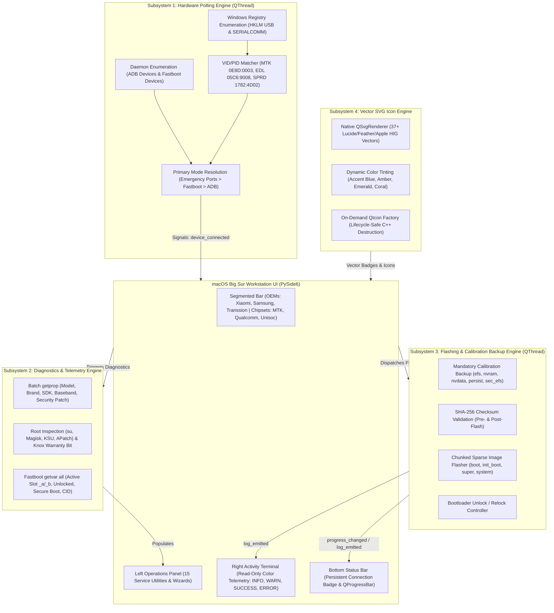
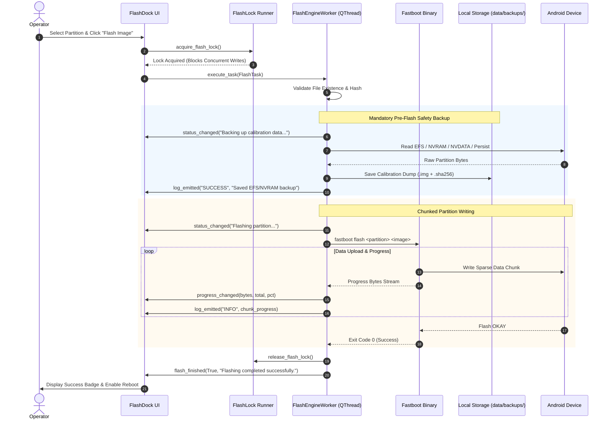
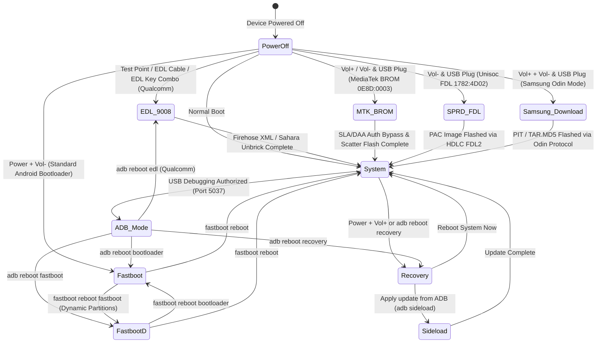

# FlashDock — Personal Android Service Workstation

[](https://github.com/klein-sys/own-flasher)
[-1D1D1F.svg)](https://github.com/klein-sys/own-flasher)
[](LICENSE)
[](tests/)
[](flashdock/ui/styles.py)
[-00F2FE.svg)](flashdock/resources/icon.png)
[](flashdock/ui/icon_assets.py)

**Personal, one-click Android service workstation for Windows.**

FlashDock handles rooting, bootloader unlocking, fastboot & custom ROM flashing, Samsung Odin tar extraction, Qualcomm EDL 9008 Sahara/Firehose rescue, MediaTek BROM scatter flashing, Unisoc PAC recovery, bootloop unbricking, Play Integrity spoofing, offline partition backup & restore, live screen mirroring (scrcpy), universal APK/XAPK/split bundle sideloading, Android 14+ low-SDK restriction bypass, recovery OTA sideloading, app debloating, hardware button navigation, laptop setup assistance, and interactive troubleshooting — all through a clean, guided macOS Big Sur-inspired interface with multi-chipset repair tool architecture (UnlockTool, TFT, Chimera).

> **Safety Warning:** This tool modifies device firmware. Always back up your critical partitions before flashing. FlashDock is designed strictly for servicing your own devices and does not support carrier bypass, FRP bypass, or IMEI modifications.

---

## Current Status — Universal Sideloading & App Manager Subsystem (v1.3.0 — Phase 23)

FlashDock features a fully modular, thread-safe, and asynchronous **GSM Suite Core Architecture** elevated with **Xiaomi HyperOS 2.0 fluidity**, **macOS Sequoia glassmorphism**, and **iOS 18 Control Center aesthetics**:

### Subsystem Architecture Diagram



### Flashing Execution & Calibration Backup Workflow



### Hardware Mode Transitions & Emergency Recovery States



### Five Major Workstation Subsystems:
1. **Connection Monitoring & Hardware Polling Engine (`device_monitor.py`)**:
   - Asynchronous `QThread` scanning USB/COM ports via zero-dependency Windows Registry enumeration.
   - Comprehensive Hardware ID (VID/PID) resolution: ADB, Fastboot, MediaTek BROM (`0E8D:0003`), MTK Preloader (`0E8D:2000`), Qualcomm EDL 9008 (`05C6:9008`), Qualcomm Diag (`05C6:9006`), Unisoc SPRD U2S Diag (`1782:4D00`), and FDL Download (`1782:4D02`).
   - Multi-tiered resolution prioritizing emergency recovery ports over standard user-space daemons.
2. **Device Diagnostics & Info Extraction Engine (`diagnostics_engine.py`)**:
   - Deep ADB property extraction: brand, model, manufacturer, build display, Android OS, baseband, security patch level, and battery level/temperature.
   - Root detection (`su` binary verification, Magisk/KSU version) and Samsung Knox warranty bit tracking.
   - Deep Fastboot `getvar all` parsing: active partition slot (`_a`/`_b`), bootloader unlocked status, Secure Boot state, CID, and max-download-size with structured fallback dictionaries.
3. **Firmware Flashing, Partition Management & Safety Backups (`flash_engine.py`)**:
   - Decoupled `QThread` external binary execution with byte-accurate progress reporting.
   - Mandatory calibration pre-backups targeting telemetry blocks (`efs`, `nvram`, `nvdata`, `persist`, `sec_efs`) with SHA-256 verification.
   - Chunked single-image flashing (`boot`, `init_boot`, `recovery`, `super`, `system`) with pre-flash checksum verification.
   - Bootloader unlock (`flashing unlock`, `oem unlock`) and relock controllers.
4. **Vector Icon Asset Manager & Image Provider (`icon_assets.py` & `brand_assets.py`)**:
   - Zero informal unicode emoji stickers in the UI. 100% vector SVG rendering adhering to Apple Human Interface Guidelines.
   - 37+ crisp, high-DPI icons (`search`, `checklist`, `warning`, `unlock`, `lock`, `root`, `flash`, `modules`, `diagnostics`, `integrity`, `backup`, `unbrick`, `return_stock`, `mtk_unisoc`, `scrcpy`, `downloads`, `logs_help`, `tools`, etc.) with dynamic tinting.
   - Clean, on-demand `QIcon` generation that prevents Qt C++ teardown access violations on Windows Python 3.14.
5. **UI Architecture & macOS Big Sur Styling (`main_window.py` & `styles.py`)**:
   - Top Segmented Bar for high-volume OEMs (Xiaomi, Samsung, Transsion, Universal Android) and Universal Chipsets (MediaTek BROM, Qualcomm EDL, Unisoc SPRD).
   - Left Operations Panel: Device Diagnostics, Partition Backup, Flash Firmware, Bootloader Tools, and Reboot Shortcuts.
   - Right Console Pane: Persistent read-only terminal with color-coded stream prefixes (`[INFO]` in Blue, `[WARN]` in Amber, `[SUCCESS]` in Green, `[ERROR]` in Red).
   - Bottom Status Bar: Persistent USB connection badge and smooth `QProgressBar`.
   - Authentic macOS Big Sur design tokens: `#F5F5F7` canvas, `#FFFFFF` rounded containers with subtle borders, `#007AFF` accent, and SF Pro typography hierarchy.

| # | Phase / Feature | Domain | Status | Key Deliverables |
|---|---|---|---|---|
| 1 | **Foundation & Architecture** | Core | Done | Rotating logger, thread-safe config, online/offline monitor, serial masking |
| 2 | **ADB & Fastboot Engine** | Device | Done | Subprocess wrappers, fastboot device tracking, Phone Control Panel |
| 3 | **Safety Checklist & Distribution** | Rescue | Done | Pre-flight safety checklist, battery/lock gates, PyInstaller build spec |
| 4 | **Bootloader Unlock Wizard** | Flashing | Done | Brand-specific unlock guides: Google Pixel, Xiaomi (token countdown), Samsung, Tecno (HiOS), Infinix (XOS), itel (itelOS), OnePlus, Motorola |
| 5 | **Partition Backup & Restore** | Rescue | Done | Slot-aware partition backups (`boot`, `init_boot`, `vbmeta`, `efs`, `persist`) with SHA-256 verification |
| 6 | **Universal Rooting Wizard** | Root | Done | Magisk (Stable/Alpha), KernelSU Next, APatch, SukiSU; boot extraction & auto-patching |
| 7 | **Root Modules & Kill-Switch** | Root | Done | Offline module repository, batch flashing, emergency bootloop recovery kill-switch |
| 8 | **Return to Stock & Anti-Relock Gate** | Flashing | Done | Factory image unpacker (Google, Xiaomi TGZ, Samsung TAR/MD5); strict anti-rollback check |
| 9 | **ROM, GSI & Recovery Flasher** | Flashing | Done | Fastboot ROM package parser, sparse chunk flasher, Treble GSI flasher, FastbootD switcher |
| 10 | **Diagnostics, Debloater & Tweaks** | Device | Done | Package manager debloater (safe user-0 disable), battery health telemetry, wireless ADB |
| 11 | **MediaTek & Unisoc Engine** | Flashing | Done | MTK BROM scatter parser, SLA/DAA auth bypass, Unisoc PAC extractor, FDL HDLC protocol |
| 12 | **Downloads & OEM Driver Manager** | Device | Done | Driver installer (Google, Samsung, Qualcomm 9008, MTK VCOM, Transsion USB, Unisoc SPD), platform-tools downloader |
| 13 | **Emergency Unbrick & EDL Flasher** | Rescue | Done | Qualcomm Emergency Download (EDL 9008), Samsung Odin PIT/TAR, MTK SP Flash, Fastboot unbrick |
| 14 | **Play Integrity & Fingerprint Spoofer** | Root | Done | PIF `pif.json` manager, custom `keybox.xml` injector, banking root-hiding card grid |
| 15 | **Logs, Telemetry & Troubleshooting** | Device | Done | Rotating application log viewer, device logcat streamer, kernel dmesg, guided interactive triage |
| 16 | **Production Hardening & Release** | Release | Done | Automated System Self-Test, non-fatal Crash Reporter, release packaging & SHA-256 checksums |
| 17 | **GSM Suite Core Subsystems** | Core / UI | Done | 4-subsystem engine (Hardware Polling QThread, Deep Diagnostics, FlashEngineWorker, macOS Big Sur UI) |
| 18 | **Vector SVG Icon Architecture** | UI / UX | Done | Centralized vector SVG asset engine, 100% unicode emoji sticker elimination across 13 screens and 11 widgets |
| 19 | **System Hardening & Brick-Prevention** | Security | Done | Active slot desync guard, ARP boot header verification, low space abort, sanitized crash reporter |
| 20 | **Next-Gen Aesthetic & Squircle Icon** | UI / UX | Done | HyperOS 2.0 fluidity, macOS Sequoia glassmorphism, iOS 18 Control Center badge chips, bespoke squircle app icon |
| + | **Transsion Brands Engine** | Brands | Done | Complete handlers for Tecno (HiOS), Infinix (XOS), itel (itelOS), and Carlcare firmware portal |
| + | **Vector Brand Badges** | UI / UX | Done | Pixel-perfect vector SVG brand logos (Google, Samsung, Xiaomi, Tecno, Infinix, itel, etc.) |
| + | **Smart Connection & Keys Helper** | Controls | Done | Interactive sidebar connection troubleshooter (USB debugging/RSA key) & contextual Hardware Key Guide |
| + | **Laptop Setup Wizard** | Workstation | Done | 4-step wizard for platform-tools, OEM drivers, laptop USB power/sleep settings & live test |

---

## Complete Workstation Navigation Matrix

FlashDock organizes its 15 workstation utilities across four curated categories:

```
FlashDock Workstation
├── Root & Modules
│   ├── Root my phone (Magisk, KernelSU, APatch, SukiSU)
│   ├── Manage Modules (Batch install, repository, kill-switch)
│   └── Fix Play Integrity (PIF spoofing, keybox injection, banking protection)
├── Flashing & ROMs
│   ├── Unlock Bootloader (Multi-brand wizards & fastboot)
│   ├── Return to Stock (Factory images & anti-relock protection)
│   ├── Flash ROM / GSI (Fastboot ROMs, GSIs, TWRP/OrangeFox)
│   └── MTK / Unisoc mode (BROM scatter & PAC flasher)
├── Rescue & Unbrick
│   ├── Safety Checklist (Pre-flight hardware verification)
│   ├── Backup / Restore (Critical partition image dumps)
│   └── Fix bricked phone (Qualcomm 9008 EDL, Odin, SP Flash)
└── Device & Tools
    ├── Check my phone (Hardware properties, slot, OS detection)
    ├── Diagnostics & Tweaks (Debloater, battery health, wireless ADB)
    ├── Downloads & Tools (Platform-tools, USB drivers, firmware finder)
    ├── Screen Mirror (Live scrcpy display & keyboard/touch control)
    ├── Logs & Help (Application telemetry, logcat streamer, triage)
    ├── Setup Laptop (Platform-tools, USB drivers, laptop power setup)
    ├── Key Guide (Physical Vol+/Vol-/Power combinations & remote)
    └── Self-Test (Prerequisites, toolchain, & permission diagnostics)
```

---

## Visual Design System (HyperOS 2.0, macOS Sequoia & iOS 18 Control Center)

- **Bespoke macOS Squircle App Icon**: Master 1024x1024 emblem with continuous curvature squircle container, frosted metallic midnight titanium rim (`#161B22` to `#0B0E14`), and glowing electric cyan (`#00F2FE` to `#4FACFE`) geometric lightning bolt docked into a stylized chipset silhouette. Multi-resolution `.ico` embedded into the Windows binary.
- **HyperOS 2.0 & iOS 18 Control Center Action Cards**: Action card buttons housed in **30x30px circular chip gradient badges** (Electric Cobalt, Neon Violet, Coral Crimson, Emerald Green, Warm Amber) with crisp `#FFFFFF` vector SVGs, 16px radius containers, and smooth drop shadows (`offset: 0, 4; blur: 16`).
- **Pill Navigation & Interactive Chips**: Elevated capsule filter pills (`border-radius: 14px; padding: 6px 14px`) and sidebar navigation pills with fluid hover transitions.
- **Window Canvas & Depth Hierarchy**: Warm Slate-Mica (`#ECEFF4` / `#F0F2F5`) and floating White Frost cards (`#FFFFFF` / `#F8F9FA`) in Light Mode; Deep Space Obsidian (`#0D1117`) and elevated Frosted Slate cards (`#181E26` / `#1A212E` with inner border highlight) in Dark Mode.
- **Recessed Obsidian Console & Form Controls**: Recessed `#080B10` terminal with JetBrains Mono font, glowing status pills (`[INFO]`, `[SUCCESS]`, `[WARN]`, `[ERROR]`, `[CMD]`), squircle text inputs with clear buttons, and elevated pill action triggers (`border-radius: 20px`).
- **High-DPI Vector Icons**: Native SVG rendering replaces emoji stickers with 37+ crisp, high-DPI vector icons adhering to Apple Human Interface Guidelines.
- **Offline Shading**: When internet connectivity drops, cloud-dependent buttons automatically dim (`opacity: 0.45; dashed border`) and update tooltips to `"[OFFLINE] Internet connection required"`.

---

## Getting Started

### Option A: Standalone Windows Binary (Recommended)
Download the standalone precompiled release from `dist/`:
1. Extract `FlashDock-v1.3.1-windows-x64.zip`.
2. Launch `FlashDock.exe` (or double-click `Run-FlashDock.bat`). No Python installation required!
3. Verify integrity against `dist/SHA256SUMS.txt`:
   - `FlashDock.exe`: `09f23e6293c0e9c663b954780d51135e2d80b56f8889ad1232e0e5ff5bfa48a9`
   - `FlashDock-v1.3.1-windows-x64.zip`: `af611258b479061328a54e969d7b38d2cdb75302f2be26d170b84d9dd586dab2`

---

### Windows Smart App Control & Defender SmartScreen Resolution

When downloading open-source binaries on Windows 11 or Windows 10, **Smart App Control (SAC)** or **Microsoft Defender SmartScreen** may show a warning banner (*"Smart App Control blocked an app that may be unsafe"* or *"Windows protected your PC: SmartScreen prevented an unrecognized app from starting"*). This occurs because Microsoft's cloud requires hundreds of thousands of corporate downloads to build automatic reputation for newly compiled binaries.

FlashDock includes built-in 1-click tools and an Authenticode digital signature to resolve this instantly:

| Method | Resolution Workflow | When to Use |
| :--- | :--- | :--- |
| **1. 1-Click Launcher (Recommended)** | Double-click **`Run-FlashDock.bat`** | Automatically strips the web download flag (`Zone.Identifier`) and launches `FlashDock.exe`. |
| **2. Install Security Certificate** | Double-click **`Install-Certificate.bat`** | Installs FlashDock's code-signing certificate (`FlashDock-Security-Certificate.cer`) into your local *Trusted Publishers* store so Smart App Control verifies the digital signature. |
| **3. SmartScreen "More Info"** | Click **More info** → **Run anyway** | Standard Windows Defender SmartScreen bypass for downloaded files. |
| **4. Manual File Unblock** | Right-click `FlashDock.exe` → **Properties** → check **Unblock** → **OK** | Permanently unblocks the executable in Windows Explorer (or double-click `Unblock-FlashDock.bat`). |
| **5. Direct Python Runner** | Double-click **`Run-Via-Python.bat`** (or `python main.py`) | Runs FlashDock from source. The Python interpreter is pre-signed by Microsoft / Python Software Foundation with universal reputation, completely bypassing Smart App Control. |

### Option B: Run from Source
```powershell
# 1. Clone repository
git clone https://github.com/klein-sys/own-flasher.git
cd own-flasher

# 2. Set up virtual environment
python -m venv .venv
.venv\Scripts\activate

# 3. Install dependencies
pip install -r requirements.txt

# 4. Launch FlashDock
python main.py
```

### Running Tests
```powershell
python scripts/release_build.py
# 466 passed in 85.88s (100% success rate)
```

---

## Safety & Brick-Prevention Principles

1. **Active Slot Desync Guard**: Verifies active Fastboot slot (`_a`/`_b`) against the connected device before writing partition images. Rejects slot-specific flashing if Fastboot reports null or ambiguous slot states.
2. **Anti-Rollback Protection (ARP / AVB 2.0)**: Binary inspection of Android `boot.img` headers (`boot_img_hdr` v0–v4) compares target OS/patch level against device counters to prevent permanent QFUSE blows and Knox warranty bit trips.
3. **Pre-Flash Partition Integrity & Low Space Abort**: Enforces calibration backups (`efs`, `nvram`, `nvdata`, `persist`, `sec_efs`) with SHA-256 verification before flashing and aborts immediately if free volume space is under 2.0 GB.
4. **USB Drop & Power Sleep Resilience**: Detects Windows USB Selective Suspend and isolates mid-flash disconnects, gracefully terminating background workers and providing actionable terminal recovery instructions.
5. **Strict Anti-Relock Gate**: Prevents users from relocking bootloaders on modified, custom, or cross-region ROMs to prevent permanent bricks.
6. **Strict Secret Masking & Telemetry Redaction**: Automatically redacts IMEI (`[REDACTED_IMEI]`), MEID (`[REDACTED_MEID]`), Android ID (`[REDACTED_ANDROID_ID]`), serial numbers (`[REDACTED_SERIAL]`), and user directories (`[USER_DIR]`). Generates local sanitized `.json` crash dumps in `data/crashes/` without leaking network sockets or system credentials.
7. **Local-First Architecture**: Firmware, drivers, modules, and cache files stay entirely on your local workstation without external telemetry dependencies.

---

## License

Distributed under the **MIT License**. See `LICENSE` for details.
