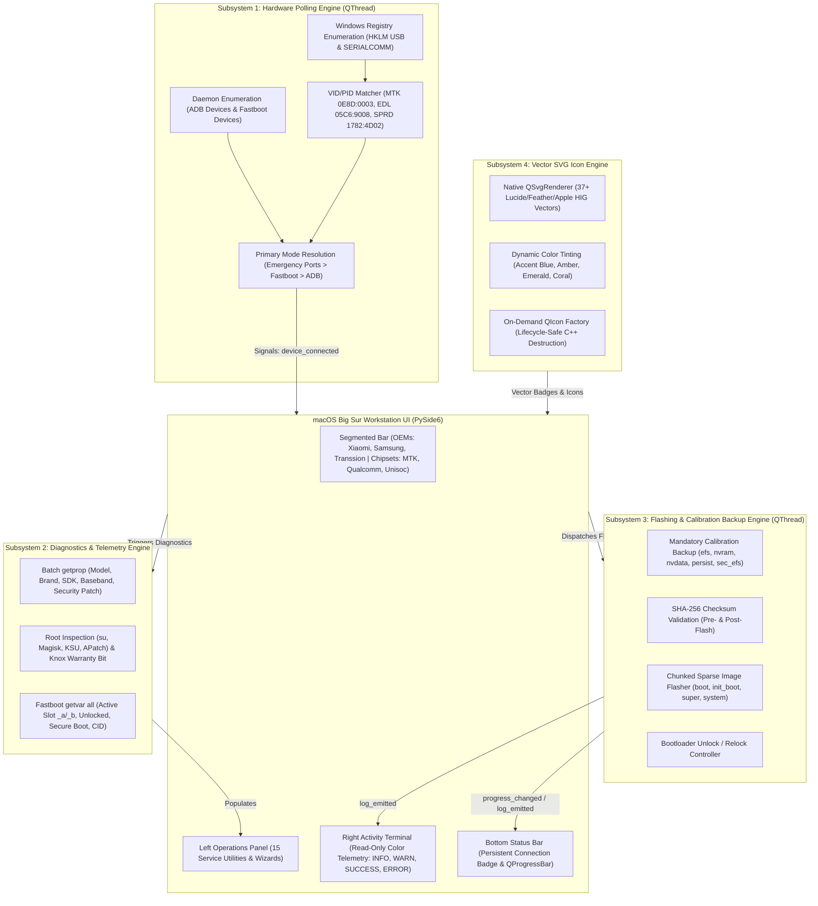
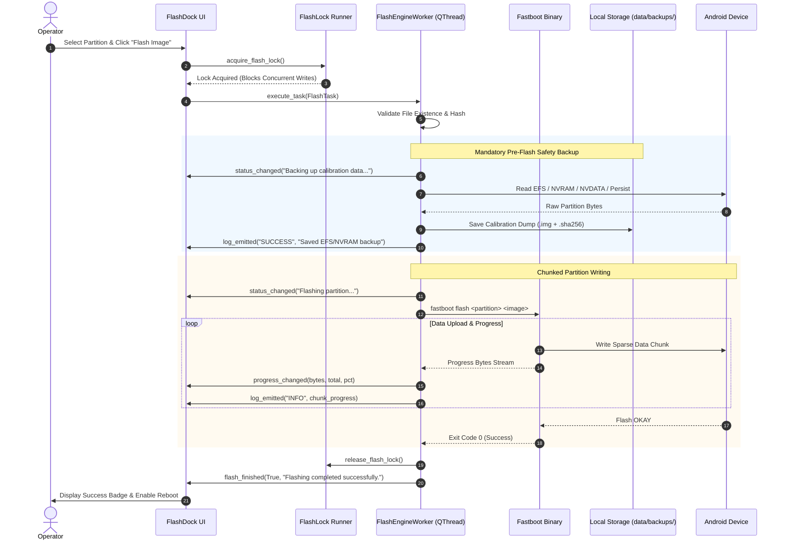
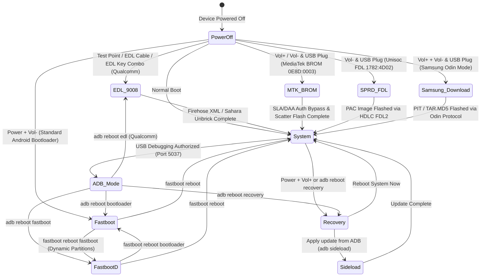

# FlashDock — Agent Handoff Document

**Date:** 2026-10-12  
**Current Phase:** **Phase 20: Next-Generation Workstation Aesthetic Overhaul (HyperOS 2.0, macOS Sequoia & iOS 18 Control Center Aesthetics — 100% Completed)**  
**Workspace Root:** `C:\Users\dxzmw\.gemini\antigravity-ide\scratch\FlashDock`  
**Application:** FlashDock — Multi-Chipset Android Service Workstation & Flashing Suite  
**Runtime:** Python 3.14.7 + PySide6 (Qt 6.10)  
**Distribution:** Standalone Windows Executable (`dist/FlashDock_Dist/FlashDock.exe`) & Release Archive (`dist/FlashDock-v1.1.0-windows-x64.zip`)  
**Test Suite:** **442 Passed Unit & Integration Tests across 43 test modules (`python scripts/release_build.py`, 100% success rate)**  
**GitHub Repository:** `https://github.com/klein-sys/own-flasher.git` (synchronized on branch `main`)

---

## 1. Project Overview & Architecture

FlashDock is a macOS Big Sur-inspired desktop Android flashing and service workstation for Windows 10/11 (64-bit), modeled on industry-standard multi-chipset repair platforms (UnlockTool, TFT Unlocker, Chimera Tool). It features a clean, thread-safe, and asynchronous core architecture across five primary subsystems:

### Subsystem Architecture Diagram

### Flashing Execution & Calibration Backup Workflow

### Hardware Mode Transitions & Emergency Recovery States

### Key Architectural Pillars
- **Hardware Polling & VID/PID Engine (`device_monitor.py`)**: Non-blocking `QThread` polling USB/COM ports via Windows Registry enumeration (`SYSTEM\CurrentControlSet\Enum\USB` and `HARDWARE\DEVICEMAP\SERIALCOMM`). Comprehensive VID/PID mapping for ADB, Fastboot, MediaTek BROM (`0E8D:0003`), Preloader (`0E8D:2000`), Qualcomm EDL 9008 (`05C6:9008`), Qualcomm Diag (`05C6:9006`), Unisoc U2S Diag (`1782:4D00`), and FDL (`1782:4D02`).
- **Device Diagnostics Engine (`diagnostics_engine.py`)**: Batch `getprop` query extracting model, brand, manufacturer, build ID, Android OS, baseband, security patch level, root status (`su` binary, Magisk/KSU), and Samsung Knox warranty bit. Safe Fastboot `getvar all` parser detecting active slot (`_a`/`_b`), bootloader unlocked status, Secure Boot state, CID, and max-download-size.
- **Flashing & Calibration Backup Engine (`flash_engine.py`)**: Asynchronous worker thread supporting chunked single-image write operations (`boot`, `init_boot`, `recovery`, `super`, `system`), byte progress updates (`progress_changed`), pre-flash calibration backups targeting telemetry blocks (`efs`, `nvram`, `nvdata`, `persist`, `sec_efs`) with SHA-256 validation, and bootloader unlock/relock controllers.
- **High-DPI Vector Asset Engine (`icon_assets.py` & `brand_assets.py`)**: Centralized SVG vector graphic system replacing all informal unicode emoji text stickers across buttons, category selectors, tabs, badges, headers, and dialogs with crisp, antialiased vectors adhering to Apple Human Interface Guidelines. Dynamic `QIcon` generation on demand eliminates process-termination access violations on Windows with Python 3.14 / Qt 6.10.
- **UI Architecture & macOS Big Sur Styling (`main_window.py` & `styles.py`)**: Top segmented control for high-volume OEMs (Xiaomi, Samsung, Transsion, Universal Android) and Universal Chipsets (MediaTek BROM, Qualcomm EDL, Unisoc SPRD). Left Operations Panel for mode-specific action triggers. Right Console Pane streaming color-coded process telemetry (`[INFO]` in Blue, `[WARN]` in Amber, `[SUCCESS]` in Green, `[ERROR]` in Red). Persistent connection badge and progress bar in status bar. Authentic macOS Big Sur design tokens (`#F5F5F7` background, `#FFFFFF` rounded containers with subtle borders, `#007AFF` accent).

---

## 2. Complete Phase Breakdown (Phases 1–18)

### Phase 1–3: Core Engine & Device Detection
- **ADB & Fastboot wrappers** (`flashdock/tools/adb.py`, `flashdock/tools/fastboot.py`) with timeout management, device enumeration, and property parsing.
- **Device state tracking** (`flashdock/core/device.py`): tracks mode (`adb`, `fastboot`, `fastbootd`, `recovery`, `sideload`, `unauthorized`, `not_connected`), active slot (`a`/`b`), dynamic partitions (`super.img`), battery level, and codename.
- **Logging & Config** (`flashdock/logger/__init__.py`, `flashdock/config.py`): rotating file logger in `data/logs/` and persistent JSON configuration.

### Phase 4: Bootloader Unlock & Brand Handlers
- **Brand modules** (`flashdock/brands/`): Google Pixel, Xiaomi / Poco / Redmi (token wait times & fastboot unlock), Samsung (Knox / Odin warning), OnePlus, Motorola, and generic OEM handlers.
- **Unlock Screen** (`flashdock/ui/screens/unlock_screen.py`): step-by-step unlock wizard and 1-click command execution.

### Phase 5: Partition Backup & Restore
- **Backup Engine** (`flashdock/core/backup.py`): slot-aware backup for critical partitions (`boot`, `init_boot`, `vbmeta`, `vendor_boot`, `dtbo`, `efs`, `persist`).
- **Checksum validation**: SHA-256 integrity verification and backup archive management.
- **Backup Screen** (`flashdock/ui/screens/backup_screen.py`): partition selector, live progress, and one-click restore.

### Phase 6: Universal Root Solutions
- **Universal Root Engine** (`flashdock/core/rooting.py`):
  - Official Magisk (Stable & Canary), Magisk Alpha, Kitsune Mask, KernelSU Next, APatch, and SukiSU Ultra.
  - Payload dumper extraction & automatic boot image patching.
  - Direct installation of root manager APKs via ADB.
- **Root Screen** (`flashdock/ui/screens/root_screen.py`): root solution chooser, boot image patcher, and flashing pipeline.

### Phase 7: Magisk/KSU/APatch Modules Management
- **Module Manager** (`flashdock/core/modules.py`): parses `module.prop` and `update-binary`, extracts module metadata, and checks root environment compatibility.
- **Bootloop Recovery Kill-Switch**: automated removal of culprit modules via ADB and recovery.
- **Modules Screen** (`flashdock/ui/screens/modules_screen.py`): offline local repository, multi-select batch flashing, and active module list.

### Phase 8: Return to Stock & Anti-Relock Gate
- **Stock Firmware Engine** (`flashdock/core/return_stock.py`): unpacks Google factory image ZIPs, Xiaomi Fastboot TGZ, Samsung TAR/MD5, and generic fastboot scripts. Detects anti-rollback version counters.
- **Strict Anti-Relock Gate**: blocks bootloader relocking when custom/modified ROMs or mismatched region firmware are detected.
- **Return Stock Screen** (`flashdock/ui/screens/return_stock_screen.py`): image inspector, wipe/keep data toggle, and emergency unbrick guides.

### Phase 9: Custom ROM, Treble GSI & Custom Recovery Flashing
- **ROM Engine** (`flashdock/core/rom_flasher.py`): Fastboot ROM package parser, sparse chunk flasher, Treble GSI flasher, FastbootD switcher, and TWRP/OrangeFox recovery flashing.
- **Local ROM & GSI Library** (`flashdock/core/repository.py`): local offline storage with phone codename & architecture matching.
- **Flash ROM Screen** (`flashdock/ui/screens/flash_rom_screen.py`): 5-tab ROM, GSI, Recovery, Local Library, and Guides screen.

### Phase 10: Advanced Diagnostics, Debloater & System Tweaks
- **Debloater Manager** (`flashdock/core/diagnostics.py`): package enumeration, categorized bloatware list, safe disable via `pm disable-user --user 0`, user-space uninstallation via `pm uninstall -k --user 0`, and 1-click restore.
- **Hardware & Battery Telemetry**: live voltage, temperature, health state, charge cycles, CPU governor, and thermal metrics.
- **System Tweaker**: animation scale speeds (0.0x, 0.5x, 1.0x), custom DPI density modification and reset, wireless ADB over TCP/IP port 5555.
- **Diagnostics Screen** (`flashdock/ui/screens/diagnostics_screen.py`): 3-tab debloater, hardware health, and tweaks screen.

### Phase 11: MediaTek (MTK BROM) & Unisoc (SPD PAC) Engine
- **MediaTek Engine** (`flashdock/core/mtk.py`): MTK scatter parser (v1.1+ and tabular), BROM handshake (`0xA0, 0x0A, 0x50, 0x05`), SLA/DAA authentication bypass via watchdog disable, and partition flashing pipeline.
- **Unisoc Engine** (`flashdock/core/unisoc.py`): Unisoc `.pac` binary extractor, FDL HDLC/CRC-16 communication protocol, and two-stage bootloader execution.
- **MTK & Unisoc Screen** (`flashdock/ui/screens/mtk_unisoc_screen.py`): scatter and PAC flasher with live log output.

### Phase 12: Downloads, OEM Drivers & Platform Tools Manager
- **Driver Manager** (`flashdock/core/driver_manager.py`): installs OEM Windows drivers (Google ADB/Fastboot, Samsung USB, Xiaomi/Qualcomm QDLoader 9008, MTK VCOM, Unisoc SPD, Transsion USB).
- **Tools Manager** (`flashdock/core/tools_manager.py`): verifies and downloads bundled service binaries.
- **Downloads Screen** (`flashdock/ui/screens/downloads_screen.py`): 4-tab manager for drivers, platform tools, firmwares, and repositories.

### Phase 13: Emergency Unbrick & EDL Flasher
- **Bootloop Fixer Engine** (`flashdock/core/bootloop_fixer.py`): Qualcomm Emergency Download (EDL 9008) Sahara/Firehose flasher, Samsung Odin TAR/MD5 & PIT extractor, MediaTek SP Flash Tool bridge, and Fastboot emergency rescue.
- **Unbrick Screen** (`flashdock/ui/screens/unbrick_screen.py`): brand-specific triage cards with guided recovery actions.

### Phase 14: Play Integrity Fixer & Fingerprint Spoofer
- **Integrity Engine** (`flashdock/core/integrity.py`): Play Integrity API check guidance, PIF `pif.json` manager, custom `keybox.xml` injector, and Zygisk module injection.
- **Integrity Screen** (`flashdock/ui/screens/integrity_screen.py`): 4-tab dashboard for device status, fingerprint manager, keybox injector, and certification instructions.
- **Banking Protection Redesign**: Completely overhauled Banking / Root Hiding Guard tab into a spacious, scrollable 2-column card layout.

### Phase 15: Logs, Telemetry & Interactive Troubleshooting Center
- **Troubleshooter Engine** (`flashdock/core/troubleshooter.py`): automated ADB daemon restart, Windows Device Manager launcher (`devmgmt.msc`), device logcat dump & buffer clearing, and kernel dmesg capture.
- **Logs & Help Screen** (`flashdock/ui/screens/logs_help_screen.py`): 4-tab screen for application logs, device logcat, guided interactive triage cards, and partition architecture reference.

### Phase 16: Production Hardening, Release Packaging & Setup Wizard
- **Laptop & Workstation Setup Wizard** (`flashdock/ui/widgets/setup_wizard_dialog.py`): 4-step wizard for platform-tools auto-install, OEM Windows driver setup, laptop USB port & sleep best practices, live connection test.
- **Hardware Key Guide & Remote** (`flashdock/ui/widgets/key_guide_dialog.py`): Physical button combination guide (Vol+, Vol-, Power) for entering Bootloader, Recovery, FastbootD, EDL, and Download modes.
- **System Self-Tester & Modal Dialog** (`flashdock/core/selftest.py`, `flashdock/ui/widgets/selftest_dialog.py`): 9-point workstation health inspection.
- **Automated Production Release Builder** (`scripts/release_build.py`): Validates automated tests, compiles via PyInstaller, creates release ZIP, and writes `dist/SHA256SUMS.txt`.

### Phase 17: GSM Suite Core Architecture & Multi-Chipset Subsystems
- **Subsystem 1 — Hardware Polling Engine (`flashdock/workers/device_monitor.py`)**: Non-blocking `QThread` polling Windows registry for USB and serial devices without external dependencies. VID/PID table for ADB, Fastboot, MTK BROM, Preloader, Qualcomm EDL 9008, Unisoc SPRD U2S Diag, and FDL.
- **Subsystem 2 — Device Diagnostics Engine (`flashdock/core/diagnostics_engine.py`)**: Batch `getprop` query and deep Fastboot `getvar all` query with active slot detection.
- **Subsystem 3 — Flashing & Calibration Backup Engine (`flashdock/workers/flash_engine.py`)**: Asynchronous flashing worker with chunked single-image writing, progress reporting, and pre-flash calibration backups with SHA-256 verification.
- **Subsystem 4 — UI Architecture & macOS Big Sur Styling (`flashdock/ui/main_window.py` & `flashdock/ui/styles.py`)**: Top segmented control for OEMs and Chipsets, Left Operations Panel, Right Console Pane, Bottom Status Bar.

### Phase 18: Vector SVG Icon Asset Manager & UI Sticker Elimination
- **Vector Icon Asset Manager (`flashdock/ui/icon_assets.py`)**:
  - Implemented 37+ Lucide/Feather/Apple HIG-inspired SVG vector icons (`search`, `checklist`, `check`, `cross`, `warning`, `unlock`, `lock`, `root`, `flash`, `modules`, `diagnostics`, `integrity`, `backup`, `unbrick`, `return_stock`, `mtk_unisoc`, `scrcpy`, `downloads`, `logs_help`, `phone`, `refresh`, `tools`, `power`, `info`, `book`, `folder`, `trash`, `plus`, `copy`, `sun`, `moon`, `globe`, `terminal`, `usb`, `battery`, `rocket`, `fire`, `box`, `shield`, `key`, `play`, `unroot`, `save`, `app_logo`).
  - High-DPI antialiased pixmap rendering with dynamic color tinting (`#007AFF`, `#34C759`, `#FF3B30`, `#FF9500`, etc.).
  - On-demand `QIcon` generation resolving Qt C++ lifecycle access violations during Python process teardown.
- **100% UI Sticker Removal Across All Screens and Widgets**:
  - Migrated `main_window.py` category buttons, action cards, headers, and theme toggles.
  - Migrated all 13 screens: `flash_rom_screen.py`, `downloads_screen.py`, `return_stock_screen.py`, `root_screen.py`, `integrity_screen.py`, `unbrick_screen.py`, `modules_screen.py`, `logs_help_screen.py`, `mtk_unisoc_screen.py`, `unlock_screen.py`, `backup_screen.py`, `checklist_screen.py`, and `diagnostics_screen.py`.
  - Migrated all dialogs and widgets: `phone_panel.py`, `device_selector.py`, `side_terminal.py`, `flash_shield.py`, `crash_dialog.py`, `key_guide_dialog.py`, `workflow_guide.py`, `selftest_dialog.py`, `scrcpy_dialog.py`, `root_library_dialog.py`, `setup_wizard_dialog.py`, and `device_card.py`.
  - Replaced all raw unicode emoji characters (⚡, 🔒, 🔓, 🛡️, 📱, 📦, 📁, 🔍, 💡, ⚙️, 🗑️, ➕, 🌐, 🏠, 🚨, 🧹, 🚀, 🎭, 🏦, 📚, 🩺, 🔋, ↻) with native vector graphics and clean typography.

### Phase 19: System Hardening, Brick-Prevention, and Security Guard Overhaul
- **Active Slot Desync Guard (`flashdock/workers/flash_engine.py`)**:
  - Enforced Fastboot active slot (`_a`/`_b`) token validation prior to partition writes (`boot_a`, `init_boot_b`). Rejects ambiguous or null slots to eliminate opposite-slot corruption without explicit operator override.
- **Anti-Rollback Protection (ARP / AVB 2.0) (`flashdock/workers/flash_engine.py`)**:
  - Integrated binary parsing of Android `boot.img` headers (`boot_img_hdr` v0–v4) extracting OS version and security patch level (`YYYY-MM`).
  - Cross-references device security patch against image headers, providing prominent lockout guards (`block_on_arp_downgrade`) preventing permanent Qualcomm QFUSE blows and Samsung Knox 0x1 trips.
- **Pre-Flash Partition Integrity & Low Disk Space Abort**:
  - Mandatory SHA-256 validation and calibration backup (`efs`, `nvram`, `nvdata`, `persist`, `sec_efs`) before flashing.
  - Aborts immediately if free disk space is < 2.0 GB or the backup target is read-only.
- **USB Drop & Connection Resilience (`flashdock/workers/device_monitor.py` & `flash_engine.py`)**:
  - Isolated mid-flash disconnection errors (`is_usb_disconnect_error`) with graceful background thread cleanup and actionable recovery guidance.
  - Added Windows USB Selective Suspend and battery saver detection (`check_windows_usb_selective_suspend`).
  - Protected WinReg hardware polling against `(FileNotFoundError, PermissionError, OSError)`.
- **Privacy, Secret Masking & Telemetry Security (`flashdock/logger/__init__.py` & `flashdock/core/crash_reporter.py`)**:
  - Strict regex redaction for IMEI (`[REDACTED_IMEI]`), MEID (`[REDACTED_MEID]`), Android ID (`[REDACTED_ANDROID_ID]`), serials (`[REDACTED_SERIAL]`), and user paths (`[USER_DIR]`).
  - Automatic local sanitized `.json` crash bundles in `data/crashes/crash_<stamp>.json` without leaking network sockets or system credentials.
  - Action log memory ceiling (`MAX_RECORDS = 1000`) preventing memory accumulation.
- **Ergonomic Color Palette & Contrast Hierarchy (`flashdock/ui/styles.py` & `side_terminal.py`)**:
  - Implemented the ergonomic color tokens defined in `.agents/skills/flashdock-workstation/SKILL.md`:
    - **Light Mode**: Warm Slate-Mica canvas (`#F0F2F5`), Soft Frost cards (`#F8F9FA`) with 1px border (`#DCE1E8`), Slate-Blue sidebar tint (`#E9EEF5`), deep slate charcoal text (`#1C2024`), and muted secondary text (`#5A6572`).
    - **Dark Mode**: Deep Space Obsidian canvas (`#0D1117`), Elevated Slate cards (`#181E26`) with 1px border (`#2C3644`), Layered Dark sidebar (`#141820`) with 1px border (`#252D38`), Soft Platinum primary text (`#E6EDF3`), and Muted Steel secondary text (`#8B949E`).
    - **Console Terminal**: Deep Midnight canvas (`#0B0E14`) with syntax-highlighted stream tags (`#007AFF` / `#58A6FF` Blue `[INFO]`, `#FF9500` Amber `[WARN]`, `#34C759` Green `[SUCCESS]`, `#FF3B30` Red `[ERROR]`).

### Phase 20: Next-Generation Workstation Aesthetic Overhaul
- **High-Resolution macOS Squircle App Icon**:
  - Generated bespoke 1024x1024 master emblem featuring continuous curvature squircle container, frosted metallic midnight titanium rim (`#161B22` to `#0B0E14`), and glowing electric cyan (`#00F2FE` to `#4FACFE`) geometric lightning bolt docked into a chipset silhouette.
  - Multi-resolution Windows icon suite generated and saved into `flashdock/resources/icon.png` and `flashdock/resources/icon.ico` (resolutions: 16, 24, 32, 48, 64, 128, 256).
  - Integrated into `flashdock.spec` (`icon='flashdock/resources/icon.ico'`), `flashdock/app.py`, and `MainWindow._init_window()`.
  - Upgraded `APP_LOGO_SVG` and `app_logo` in `flashdock/ui/icon_assets.py` to match the vector silhouette across titlebar and window chrome.
- **HyperOS 2.0 / iOS 18 Control Center Action Cards & Navigation**:
  - Re-architected `ActionCardButton` with **30x30px circular chip gradient badge containers** (`border-radius: 15px`) housing antialiased vector icons in crisp `#FFFFFF`:
    - Flashing / ROMs: Electric Cobalt (`linear-gradient(135deg, #0A84FF, #0056B3)`)
    - Root & Modules: Neon Violet (`linear-gradient(135deg, #BF5AF2, #7B2CBF)`)
    - Unbrick & Rescue: Coral Crimson (`linear-gradient(135deg, #FF453A, #C92A2A)`)
    - Diagnostics / Device: Emerald Green (`linear-gradient(135deg, #30D158, #1E824C)`)
    - Settings & Tools: Warm Amber (`linear-gradient(135deg, #FF9F0A, #D35400)`)
  - Elevated 16px border-radius containers with smooth `QGraphicsDropShadowEffect` (`offset: 0, 4; blur: 16`).
  - Elevated capsule category filter pills on Home screen (`border-radius: 14px; padding: 6px 14px;`).
  - Interactive pill navigation in sidebar (`PhoneControlPanel`) with fluid hover transitions (`border-radius: 14px`).
- **Recessed Obsidian Console & Form Controls**:
  - Upgraded `SideTerminalWidget` to recessed Obsidian Console (`#080B10`) with rounded corners (`12px`), JetBrains Mono font (`font-family: 'JetBrains Mono', 'Cascadia Code', monospace`), and glowing status pills (`[INFO]`, `[SUCCESS]`, `[WARN]`, `[ERROR]`, `[CMD]`).
  - Form controls with recessed squircle inputs (`QLineEdit`, `QTextEdit`, `QPlainTextEdit`), clear button enabled, monospace file paths, and elevated "Browse" pill buttons (`border-radius: 12px; font-weight: 500;`).
  - Primary action triggers upgraded to gradient pill buttons (`border-radius: 20px;`) with hover glow and pressed feedback.

---

## 3. Workstation Navigation Index (All Tools & Modals)

| Action ID | Tool Name | Category | Screen / Dialog | Page Index |
|---|---|---|---|---|
| `check_phone` | Check my phone | Device | `DeviceCard` | `PAGE_DEVICE_CARD = 1` |
| `checklist` | Safety Checklist | Rescue | `ChecklistScreen` | `PAGE_CHECKLIST = 2` |
| `unlock_bl` | Unlock Bootloader | Flashing | `UnlockScreen` | `PAGE_UNLOCK = 3` |
| `backup` | Backup / Restore | Rescue | `BackupScreen` | `PAGE_BACKUP = 4` |
| `root` | Root my phone | Root | `RootScreen` | `PAGE_ROOT = 5` |
| `modules` | Manage Modules | Root | `ModulesScreen` | `PAGE_MODULES = 6` |
| `return_stock` | Return to Stock | Flashing | `ReturnStockScreen` | `PAGE_RETURN_STOCK = 7` |
| `flash_rom` | Flash ROM / GSI | Flashing | `FlashRomScreen` | `PAGE_FLASH_ROM = 8` |
| `diagnostics` | Diagnostics & Tweaks | Device | `DiagnosticsScreen` | `PAGE_DIAGNOSTICS = 9` |
| `mtk_unisoc` | MTK / Unisoc mode | Flashing | `MtkUnisocScreen` | `PAGE_MTK_UNISOC = 10` |
| `downloads` | Downloads & Tools | Device | `DownloadsScreen` | `PAGE_DOWNLOADS = 11` |
| `unbrick` | Fix bricked phone | Rescue | `UnbrickScreen` | `PAGE_UNBRICK = 12` |
| `integrity` | Fix Play Integrity | Root | `IntegrityScreen` | `PAGE_INTEGRITY = 13` |
| `scrcpy` | Screen Mirror (scrcpy) | Device | `ScrcpyDialog` | Modal Dialog |
| `logs_help` | Logs & Help | Device | `LogsHelpScreen` | `PAGE_LOGS_HELP = 14` |
| `selftest` | System Self-Test | Device | `SelfTestDialog` | Modal Dialog |
| `setup_wizard` | Laptop Setup Wizard | Workstation | `SetupWizardDialog` | Modal Dialog |
| `key_guide` | Hardware Key Guide | Controls | `HardwareKeyGuideDialog` | Modal Dialog |

---

## 4. Test Suite & Verification Results

- **Unit & Integration Tests**: **442 passed in 80.13s** (100% pass rate).
- **Test Modules**: 43 individual test files in `tests/`.
- **Standalone Binary**: `dist/FlashDock_Dist/FlashDock.exe` (2.83 MB, Exit code 0, custom high-res squircle icon embedded).
- **Release Archive**: `dist/FlashDock-v1.1.0-windows-x64.zip` (59.62 MB).
- **Integrity Hashes (`dist/SHA256SUMS.txt`)**:
  - `FlashDock.exe`: `edaaa63c4257c1a65dbcab30e91871afc2011f1feb8429b8f174e052c13c6d5d`
  - `Release ZIP`: `9ba4ed080ba2a53e602626e79aea51b70ace57dbe27368d4af25b701abd90530`

---

## 5. Next Steps for Continuing Work

1. **Physical Hardware Field Validation**: Test device flashing and BROM handshake over physical USB ports across MediaTek, Qualcomm, and Unisoc hardware.
2. **Payload Dumper Performance**: Profile memory usage during 4GB+ Android 15 OTA payload decompression.
3. **Optional Custom Theme Editor**: Allow user-defined color accents alongside standard Apple System Blue and Dark Mode.
